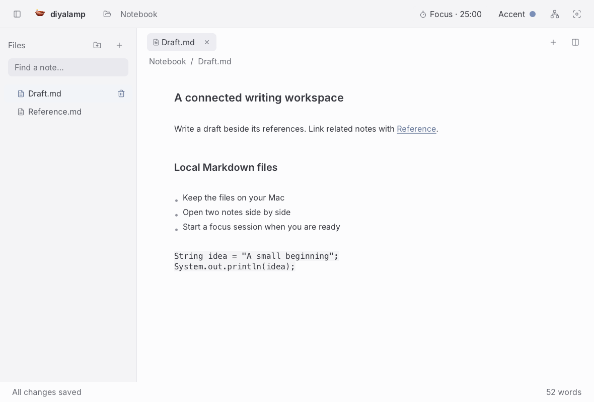

<div align="center">
  <h1> diyalamp</h1>
  <p><strong>Open-source Markdown editor for macOS.</strong></p>
  <p>Live formatting · Local .md files · Multiple tabs · Split view · No sign-up</p>
  <p><a href="https://diyalamp.com">Website</a> · <a href="https://github.com/diyalamp/diyalamp/releases">Releases</a> · <a href="https://github.com/diyalamp/diyalamp/issues">Issues</a> · <a href="CONTRIBUTING.md">Contributing</a></p>
  
  
</div>

## Overview

diyalamp is a desktop Markdown editor with rendered formatting and local file storage. It is an open-source alternative to Typora and a no-sign-up option for personal writing in a Notion-like interface.

The application opens a folder of `.md` or `.markdown` files. Editing does not require an account, subscription, server, database, or internet connection. Notes remain readable by other Markdown tools.

## Features

- Light-only macOS workspace with the installed system font, Menlo for code, a file explorer, note tabs, and Lucide controls.
- Rendered headings, bold, italic, inline code, links, lists, checklists, quotes, and fenced code blocks.
- Formatting controls, Markdown typing shortcuts, and slash commands.
- Folder explorer with nested Markdown files, filename search, closable note tabs, and side-by-side editing.
- Local autosave with external-file conflict detection.
- Note creation, import, rename, export, recoverable deletion, and restore.
- Undo/redo and macOS keyboard shortcuts.
- `[[Note name]]` links with directed incoming/outgoing navigation and a SmartGraph panel.
- Smooth Zen mode, interrupted accent transitions, and consistently styled dialogs.
- A 25-minute focus / 5-minute break Pomodoro with Start, Pause, and Reset.
- Drag tabs between panes or move notes into workspace folders without overwrites.
- Six muted accent choices in the tab toolbar, plus explicit in-app update checks.



_Workspace preview using fictional notes._

## macOS downloads

Version **1.1.1** is available from [GitHub Releases](https://github.com/diyalamp/diyalamp/releases/tag/v1.1.1) and [diyalamp.com](https://diyalamp.com).

- [Apple silicon DMG · 47.1 MB](https://github.com/diyalamp/diyalamp/releases/download/v1.1.1/diyalamp-1.1.1-macos-arm64.dmg)
- [Intel DMG · 48.5 MB](https://github.com/diyalamp/diyalamp/releases/download/v1.1.1/diyalamp-1.1.1-macos-x86_64.dmg)

Drag diyalamp to Applications. See the [installation guide](docs/install.md) for choosing Apple silicon or Intel, verifying the SHA-256 checksum, first-launch approval, and current macOS compatibility limits.

**Size target: under 5 MB installed. This target has not been achieved.** Footprint reduction is tracked as an engineering objective, not a current product claim.

The package includes a runtime; users do not need to install Java separately. The Apple silicon app from the verified release DMG occupies approximately **63.8 MiB**. Release downloads are **47,054,874 bytes** (Apple silicon) and **48,502,211 bytes** (Intel). Architecture and runtime builds can differ; release assets provide SHA-256 checksums.

This community release is **unsigned and not Apple-notarized**. macOS may display a security warning. Signing and notarization are not configured yet.

## Build and test

Requires JDK 25 or newer. The desktop app uses JavaFX, AtlantaFX, RichTextFX, Lucide icons, and CommonMark Java. Fonts come from macOS; no font files are bundled. There is no JavaScript runtime or web backend in the desktop application.

```sh
sh desktop/build.sh
sh desktop/run.sh
sh desktop/test.sh
```

To package a self-contained app and DMG on macOS:

```sh
sh desktop/package-macos.sh
```

See [`desktop/README.md`](desktop/README.md) for dependency checksums, architecture builds, and development with a separate notes folder. Tests cover Markdown round trips, save conflicts, filename collisions, deletion recovery, and file boundaries.

## Storage and privacy

- Choose the notes folder with Open Folder; Markdown stays in that folder.
- Notes are UTF-8 Markdown files, saved locally.
- A file changed by another application is not silently overwritten; edits stay open for export.
- Deleted notes move to `.diyalamp-trash` inside the notes folder and can be restored.
- Embedded HTML is treated as text. Remote images and scripts are not downloaded or executed.
- No account or telemetry service is part of the desktop writing flow.

## Scope

This release supports common Markdown editing. It does not implement the complete CommonMark specification, rich table rendering, remote-image previews, plugins, sync, team databases, or publication integrations. Unsupported text is retained rather than executed.

The [browser notebook](https://diyalamp.com/#workspace) is a separate demonstration; its browser storage is not automatically synced with desktop files. Website source is in [diyalamp.github.io](https://github.com/diyalamp/diyalamp.github.io).

Previous AI-agent, browser-automation, and writing-review experiments remain in the repository history and existing folders. They are not dependencies of the desktop editor. Current application development belongs in `desktop/`.

## Contributing

Read [CONTRIBUTING.md](CONTRIBUTING.md) and [product scope](docs/PRODUCT.md). Use [Issues](https://github.com/diyalamp/diyalamp/issues) for reproducible bugs, Markdown compatibility cases, accessibility checks, and proposed improvements. Do not attach private notes or credentials.

## License

[Apache License 2.0](LICENSE). Dependencies and brand assets retain their own notices in [THIRD_PARTY_NOTICES.md](THIRD_PARTY_NOTICES.md).
