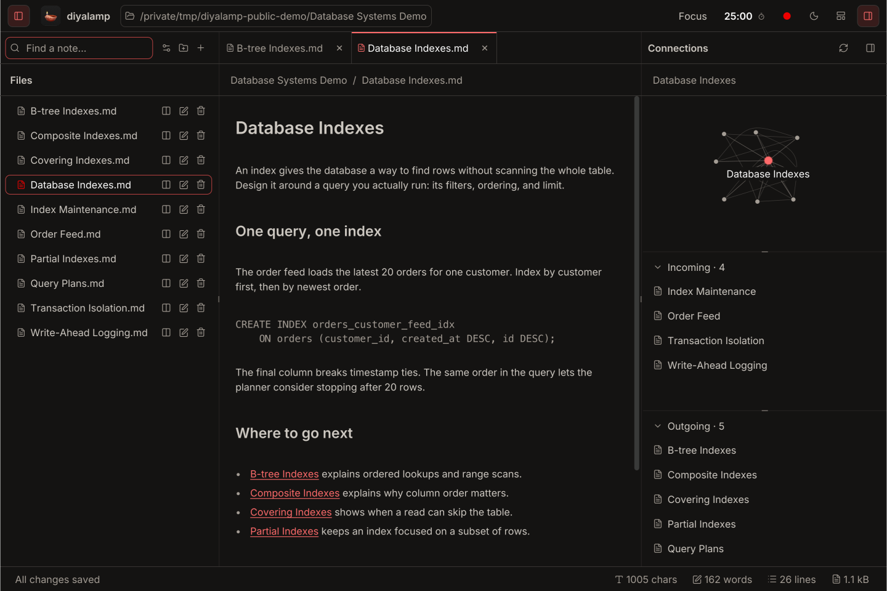
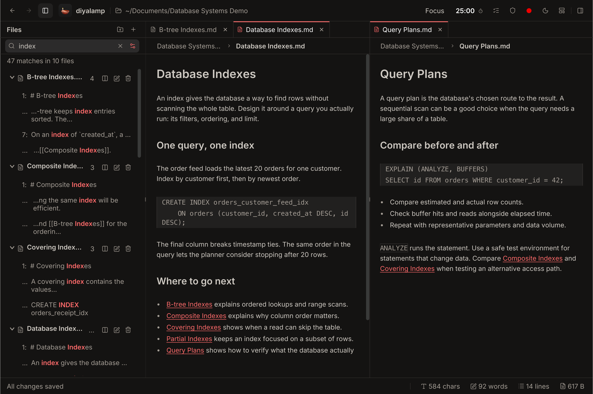
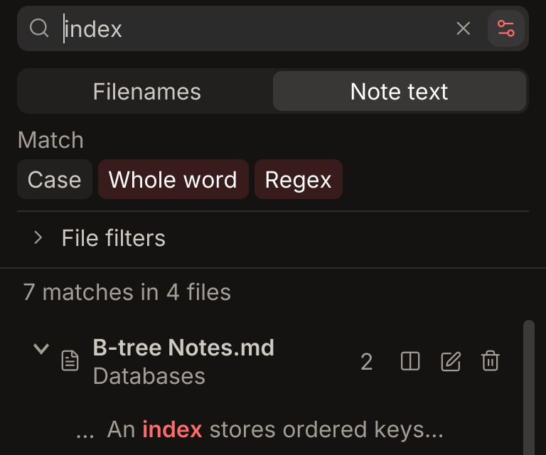
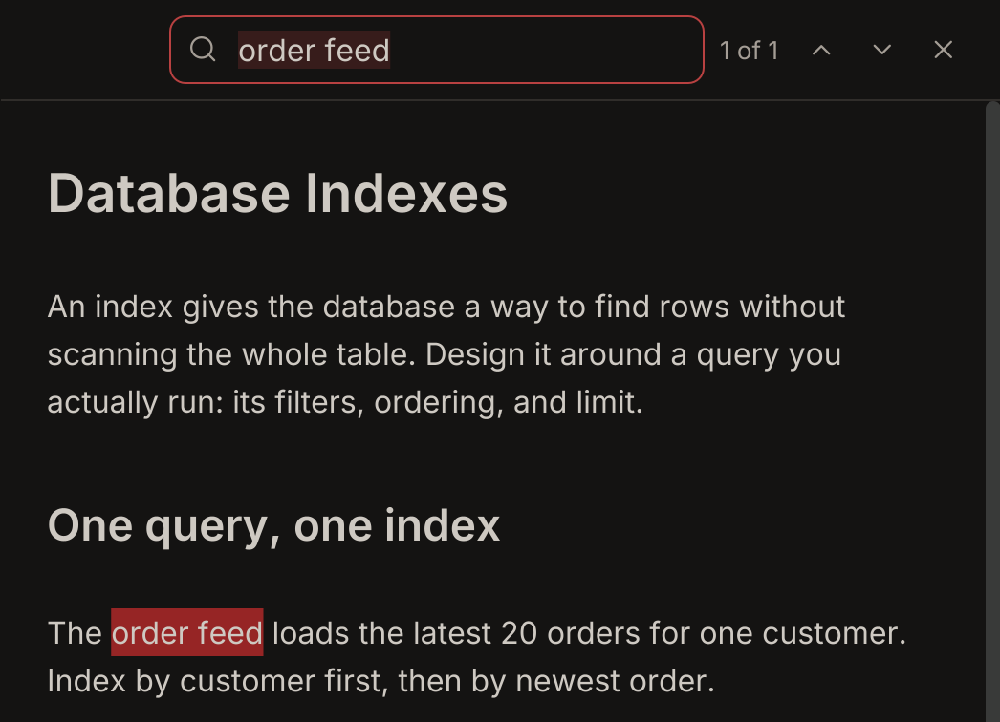
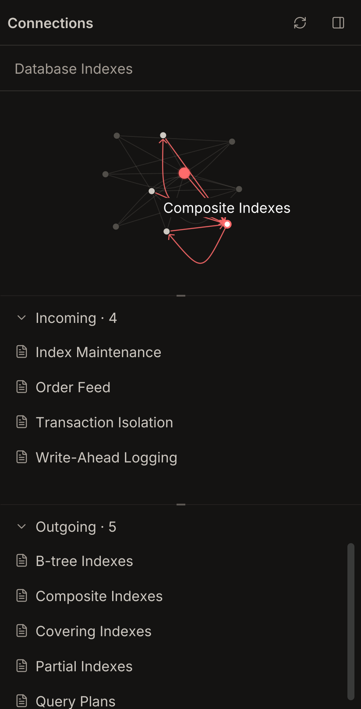
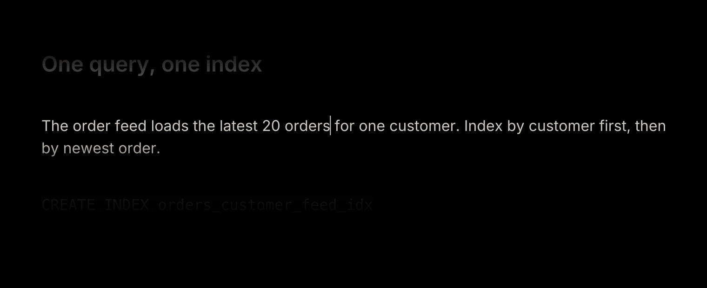
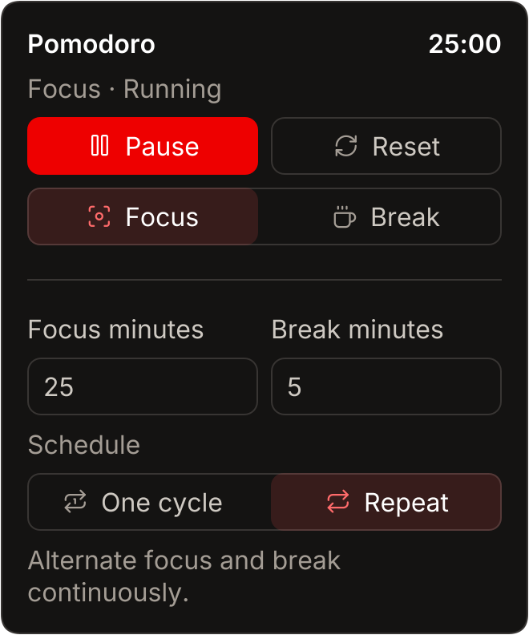
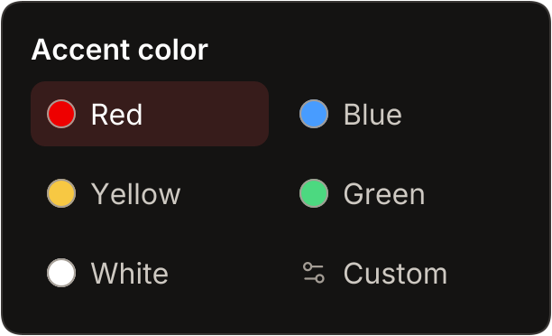

<div align="center">
  <h1> diyalamp</h1>
  <p><strong>Your commonplace book.</strong></p>
  <p>Collect what you read and learn in a folder of Markdown notes. Write with live formatting, search your notes, and follow connections between them.</p>
  <p>Free forever · Open source · No sign-up · macOS</p>
  <p><a href="#download-for-mac"><strong>Download for Mac</strong></a> · <a href="https://diyalamp.com/">Website</a> · <a href="https://github.com/diyalamp/diyalamp/releases/tag/v1.3.5">Release notes</a></p>
</div>

<p align="center">
  <a href="docs/assets/database-workspace.webp"></a><br>
  <sub>Database Indexes, with its incoming and outgoing note links.</sub>
</p>

## Download for Mac

Version **1.3.5** includes the runtime. Open **Apple menu → About This Mac** to choose your installer. Select Apple silicon if you see an Apple chip and Intel if you see an Intel processor.

| Mac | Installer | SHA-256 |
| --- | --- | --- |
| Apple silicon | [Download DMG · 42.2 MB](https://github.com/diyalamp/diyalamp/releases/download/v1.3.5/diyalamp-1.3.5-macos-arm64.dmg) | [Checksum](https://github.com/diyalamp/diyalamp/releases/download/v1.3.5/diyalamp-1.3.5-macos-arm64.dmg.sha256) |
| Intel | [Download DMG · 43.8 MB](https://github.com/diyalamp/diyalamp/releases/download/v1.3.5/diyalamp-1.3.5-macos-x86_64.dmg) | [Checksum](https://github.com/diyalamp/diyalamp/releases/download/v1.3.5/diyalamp-1.3.5-macos-x86_64.dmg.sha256) |

Sizes are compressed DMG downloads. The [under-5-MB installed target](https://github.com/diyalamp/diyalamp/issues/2) is an open engineering goal.

Open the DMG and drag **diyalamp** into **Applications**. Then press `⌘O` to open your Markdown folder. The release is ad hoc signed, and macOS may require first-launch approval. The [install guide](docs/install.md) covers that prompt, checksum verification, macOS compatibility, and updates.

## The writing workspace

Edit headings, checklists, quotes, links, and fenced code blocks with live formatting. Type `/` on an empty line for block commands. Drag a note into a second pane to keep a reference in view while you write. Reorder tabs, rename a note inline, or drag it to another folder.

<p align="center">
  <a href="docs/assets/database-search-and-split.webp"></a><br>
  <sub>Search note text while keeping Database Indexes and Query Plans open.</sub>
</p>

### Search the folder or the open note

Use `⌘P` to find files, `⌥⌘F` to search text across the folder, or `⌘F` to find text in the open note. Workspace filters support case, whole words, regular expressions, and included or excluded paths.

<p align="center">
  <a href="docs/assets/workspace-search.webp"></a>
  <a href="docs/assets/find-in-note.webp"></a>
</p>

### Follow links and backlinks

Type `[[Note name]]` or use a relative Markdown link. The Connections panel shows the active note’s graph along with its incoming and outgoing links.

<p align="center">
  <a href="docs/assets/connections-hover.webp"></a>
</p>

### Keep the active line in view

Focus mode keeps the line you’re writing bright and dims the surrounding text and workspace.

<p align="center">
  <a href="docs/assets/focus-active-line.webp"></a>
</p>

### Set a timer and choose an accent

Set focus and break lengths in the toolbar Pomodoro, then run one cycle or repeat. Choose an accent preset or enter your own hex color.

<p align="center">
  <a href="docs/assets/pomodoro-controls.webp"></a>
  <a href="docs/assets/accent-palette.webp"></a>
</p>

## Bring your notes

| Coming from | What to try |
| --- | --- |
| **Obsidian** | Open a copy of your vault folder to edit its Markdown and follow backlinks. Obsidian remains useful for plugins, Canvas, and a vault-wide graph. |
| **Notion** | Export **Markdown & CSV**, unzip it, and open the resulting folder. diyalamp is for account-free writing on local files. Notion provides shared workspaces and databases. |
| **Typora** | Open your existing Markdown folder for rendered editing, folder search, and backlinks under a free license. Typora offers richer tables, equations, and diagrams. |

See [the comparison and migration guide](https://diyalamp.com/alternatives/) for details.

## Files, privacy, and updates

- Notes are UTF-8 `.md` or `.markdown` files in the folder you choose. Writing works offline without an account or telemetry service.
- Autosave checks for edits made by another app before writing. If there is a conflict, your edits remain available to export. Deleted notes can be restored from `.diyalamp-trash` inside the workspace.
- Embedded HTML stays literal and remote image references stay on the page as text. The editor supports common Markdown syntax. See [product scope](docs/PRODUCT.md) for format limits.
- **Help → Check for updates** checks GitHub when you ask. The updater verifies the matching installer and saves pending edits before applying it. A save conflict cancels installation.

## Build and test

Install **JDK 25 or newer** and run from the repository root. The desktop app uses JavaFX, AtlantaFX, RichTextFX, SmartGraph, and CommonMark Java.

```sh
sh desktop/build.sh
sh desktop/run.sh
sh desktop/test.sh
```

To create a self-contained app and DMG on a Mac with Apple’s command-line tools, run `sh desktop/package-macos.sh`. The [desktop build guide](desktop/README.md) covers verified dependencies, architecture builds, and running against a separate notes folder. Current desktop development is in `desktop/`. The [website source](https://github.com/diyalamp/diyalamp.github.io) lives in a separate repository.

## Contribute

If diyalamp fits your workflow, star the repository to follow the project. For code changes, start with the [contribution guide](CONTRIBUTING.md). Share reproducible bugs in [Issues](https://github.com/diyalamp/diyalamp/issues) using sample notes. A keyboard or [VoiceOver review](https://github.com/diyalamp/diyalamp/issues/1) is also welcome.

[Apache License 2.0](LICENSE) · [Third-party notices](THIRD_PARTY_NOTICES.md)
